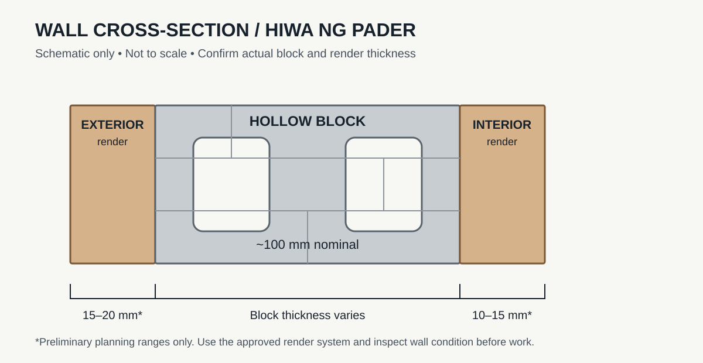
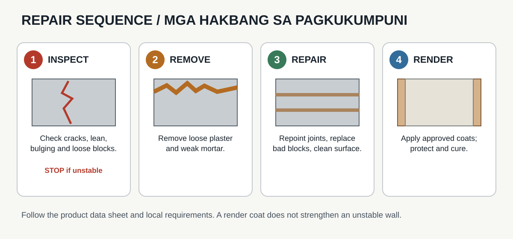
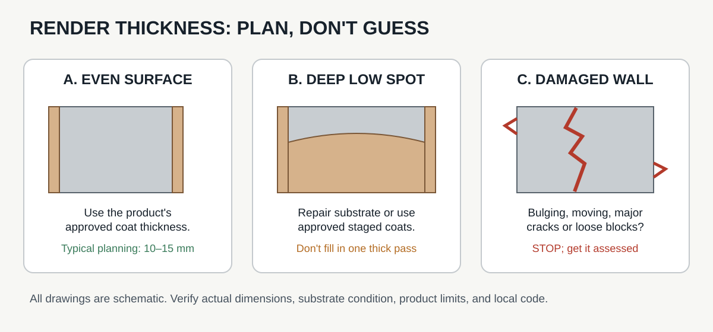

# Tropical Masonry Repair Field Guide
## Repairing and Replastering an Existing 4-Inch Hollow Concrete Block Wall

**Document type:** Preliminary field work guide for masons and site supervisors  
**Application:** Repair and leveling of both faces of an existing hollow concrete masonry wall in a hot, humid, rain-exposed tropical climate  
**Status:** Field guidance only. Not a structural design, stamped specification, or substitute for local building-code requirements.

## Visual references

### Wall cross-section

### Repair sequence

### Render thickness planning

For reference construction photographs and licensing/attribution, see [Photo References and Attribution](photo-references.md). Photos are examples only and do not depict the actual wall being repaired.

## 1. Purpose and scope
This guide describes a safe work sequence for assessing, repairing, leveling, and finishing an existing nominal 4-inch (approximately 100 mm) hollow concrete block wall whose surfaces and/or mortar joints have deteriorated.

1. Inspect the wall and decide whether it is safe to repair in place.
2. Remove loose material and repair unsound masonry.
3. Prepare the substrate.
4. Apply compatible cementitious leveling/render coats to both faces as needed.
5. Cure and protect the work from sun, wind, and heavy rain.
6. Inspect the finished work and address moisture entry at its source.

**Important:** Plaster or a thick mortar “skin” is a finish layer. It does not restore the structural capacity of failed blocks, missing reinforcement, weak foundations, or a wall that is leaning or moving.

## 2. Stop-work conditions
Do not cover the wall with new mortar until a qualified builder, engineer, or other locally authorized professional has assessed it if any of the following are present:
- The wall is leaning, bulging, moving, or separating from columns or adjoining walls.
- There are wide, stepped, diagonal, or actively growing cracks.
- Blocks are loose, hollow-sounding over large areas, crumbling deeply, or missing.
- The base is persistently wet, washed out, undermined, or damaged.
- Reinforcing steel is exposed or corroded, or a lintel, bond beam, column, or foundation appears damaged.
- The wall supports a roof, floor, retaining load, or other significant load and its condition is uncertain.
- The wall may be vulnerable to earthquake or typhoon wind loads and its structural details are unknown.

Keep people clear of an unstable wall. Do not rely on plaster, wire mesh, or surface mortar to hold an unstable wall together.

## 3. Preliminary thickness guidance
Thicknesses below are starting points for planning, not mandatory values for every wall. Actual thickness depends on substrate condition, the chosen product, local standards, and site inspection.

| Layer or operation | Preliminary target | Notes |
|---|---:|---|
| Existing block wall | Nominal 100 mm (4 in) | Measure the actual block; nominal and actual dimensions can differ. |
| Bed/head joints in new or rebuilt masonry | About 10 mm (3/8 in) | Follow the block and mortar specification; do not use thick joints to compensate for badly misaligned blocks. |
| Sound-surface leveling/render coat | Commonly 10–15 mm (3/8–5/8 in) per face | Use only where the chosen render system permits this thickness. |
| Exterior render | Often around 15–20 mm (5/8–3/4 in) total where specified | Planning range only; some systems require thinner or multi-coat application. |
| Interior render | Often around 10–15 mm (3/8–5/8 in) total where specified | Wet areas require compatible waterproofing details, not simply thicker plaster. |
| Deep low spots | Do not fill automatically in one thick pass | Use a compatible multi-coat repair system or repair/rebuild masonry first. Follow product limits. |

### Approximate finished wall thickness
If the block is actually 100 mm thick and each face receives 10–15 mm of render, the wall will be approximately **120–130 mm (4.7–5.1 in)** thick before paint, tiles, or other finishes.

If the exterior face receives 15–20 mm and the interior face 10–15 mm, the approximate total is **125–135 mm (4.9–5.3 in)** before finish coatings. Measure the actual wall and allow for unevenness.

Do not specify a blanket 20–40 mm mortar layer over an entire face without checking the render system and substrate. Thick, poorly bonded layers can shrink, crack, or detach.

## 4. Materials and equipment
Select materials as a compatible system and follow the manufacturer's current instructions.

### Materials
- Cementitious masonry repair mortar suitable for the existing block and exposure.
- Cement-based plaster/render mortar appropriate for the intended thickness and substrate.
- Clean, properly graded plaster sand and approved clean mixing water, if site-mixed mortar is permitted by the specification.
- Manufacturer-approved bonding agent or substrate primer, only where required by the chosen system.
- Alkali-resistant render mesh or other reinforcement only where specified for crack-prone transitions or by the render-system instructions.
- Compatible breathable exterior coating or weatherproof finish.
- Temporary sheeting or shade cloth to protect fresh work from heavy rain and rapid drying.

Avoid excess water, detergent, salt, or unapproved additives. Do not mix incompatible products or apply a waterproof coating that traps moisture unless the full system is designed for it.

### Tools and PPE
- Eye protection, gloves, suitable dust mask/respirator, sturdy footwear.
- Hammer and masonry chisel or suitable controlled removal tools.
- Stiff masonry brush and clean water supply.
- Trowels, hawk, straightedge/screed, level or plumb line, mixing equipment, and measuring containers.
- Stable access equipment; do not stand on improvised platforms.
- Suitable barriers and debris collection.

Control silica-containing dust. Avoid dry grinding or dry sweeping; use suitable dust suppression and local safety practices.

## 5. Work procedure

### Step 1 — Inspect and document
1. Photograph both faces, the wall base, corners, openings, lintels, roof junctions, and cracks.
2. Mark loose plaster, crumbling joints, damp areas, salt deposits, and cracks.
3. Check whether damage is surface-level or extends into blocks and joints.
4. Identify water sources: leaking pipes, roof runoff, failed gutters, ground splash, rising damp, or water entering around windows.
5. If a stop-work condition in Section 2 exists, obtain a competent assessment before continuing.

### Step 2 — Remove unsound material
1. Remove loose paint, plaster, powdery render, and weak mortar until a sound substrate is reached.
2. Repoint deteriorated joints using compatible masonry repair mortar.
3. Replace blocks that are badly fractured, deeply eroded, or no longer securely bonded. Do not simply bury them under render.
4. Avoid damaging block webs, reinforcement, embedded services, or adjacent sound masonry.
5. Collect debris and clean the work area.

### Step 3 — Correct water entry and substrate defects
1. Repair leaks and drainage defects before finishing the wall.
2. Ensure roof runoff is directed away from the wall and ground splash is controlled.
3. Check window/door perimeters, parapets, wall tops, and penetrations for suitable flashing, caps, drips, and seals.
4. Do not seal over active dampness or salt contamination without determining the cause.
5. Where rising damp or persistent moisture is suspected, seek an appropriate diagnosis and detail.

### Step 4 — Prepare the block surface
1. Remove dust and loose particles with a brush and suitable cleaning method.
2. Follow the render manufacturer's requirements for pre-wetting or priming. Traditional cementitious render often requires a uniformly damp, surface-dry substrate, not standing water.
3. Do not apply render to a dusty, oily, friable, or otherwise unsuitable surface.
4. Use bonding agents only when compatible with the mortar and required by the system.

### Step 5 — Establish the required plane
1. Set reference points using a plumb line, level, or straightedge.
2. Identify high spots and low spots. Remove small high spots only where safe and appropriate.
3. Determine the required thickness at several locations on each face.
4. If much of the wall needs a very thick build-up, reconsider whether masonry repair/rebuilding or a designed multi-coat system is more appropriate.
5. Confirm the render product's permitted minimum and maximum thickness per coat before mixing.

### Step 6 — Apply repair and leveling coats
1. Mix mortar exactly as specified by the product data or approved site mix. Do not guess the water amount.
2. Apply repair mortar to prepared joints and localized defects first, allowing it to set/cure as directed.
3. Apply the leveling/render coat firmly to achieve good contact with the substrate.
4. Use a straightedge to bring the surface to the required plane without overworking or adding water to the face.
5. For thickness beyond the product's single-coat limit, use the approved staged method. Follow required intervals and surface preparation between coats.
6. Install mesh or reinforcement only where the approved system calls for it. Mesh is not a substitute for structural repair.
7. Keep joints, movement joints, drainage paths, weep holes, and service access clear. Do not bridge a movement joint with rigid render.

### Step 7 — Cure and protect
1. Protect fresh render from direct harsh sun, strong wind, heavy rain, and impact.
2. Follow the mortar/render manufacturer's curing method and duration. Cementitious work generally needs protection against rapid moisture loss.
3. Where wet curing is specified, keep the surface appropriately damp without washing out the finish.
4. Do not paint or apply a membrane until the render has reached the manufacturer's required curing and moisture condition.
5. Do not use an arbitrary one-day cure for all materials and weather conditions.

### Step 8 — Apply finish and weather protection
1. Confirm the render is sound, adequately cured, and free of loose material, unacceptable cracks, and persistent dampness.
2. Use a compatible exterior coating designed for the exposure. Prefer a system that manages water while allowing appropriate vapor transmission for the wall assembly.
3. For bathrooms or other wet areas, use the specified waterproofing system at the correct location, with correct corner, pipe, and floor/wall details.
4. Do not assume paint alone will correct active leakage or defective flashing.

## 6. Tropical-climate controls
- **Heavy rain:** Do not apply mortar before forecast heavy rain unless the work can be protected adequately.
- **Heat and wind:** Shade the work and manage curing to reduce rapid drying and shrinkage.
- **Humidity:** High humidity does not remove the need for curing or adequate drying before coatings.
- **Salt air/coastal exposure:** Use materials and fixings suitable for the exposure; investigate salt deposits and corrosion.
- **Ground moisture:** Prevent soil, paving, and stored materials from directing water into the wall. Use appropriate damp-proofing and drainage details.
- **Typhoon and earthquake exposure:** Have structural stability, wall anchorage, reinforcement, and connections evaluated where required. A plaster skin is not a wind- or earthquake-resisting retrofit.

## 7. Quality-control checklist
Before accepting each face of the wall, the site supervisor should confirm:
- [ ] No unstable or loose masonry remains.
- [ ] Damaged joints and blocks were repaired rather than concealed.
- [ ] Water entry and drainage problems have been addressed.
- [ ] The substrate was clean and prepared as required.
- [ ] The chosen product permits the applied thickness and substrate.
- [ ] Render is firmly bonded, with no widespread hollow or detached areas.
- [ ] Surface is acceptably plumb/flat for the specified finish.
- [ ] Corners, openings, joints, penetrations, and drainage details remain functional.
- [ ] Fresh work was protected and cured according to instructions.
- [ ] Exterior finish is compatible with the render and exposure.
- [ ] Cracks, damp patches, salt deposits, or debonding are investigated before handover.

Record product names, batch numbers, mixing instructions, application dates, weather, coat thicknesses, and curing method.

## 8. Estimating render quantity
Measure the net area of each face in square metres:

`Net area = wall length × wall height − openings`

For a rough volume estimate:

`Wet render volume (m³) = net area (m²) × average thickness (m)`

Example: 10 m² at an average thickness of 12 mm (0.012 m) gives a theoretical volume of 0.12 m³. Actual purchase quantities depend on product yield, surface roughness, waste, and application method. Use the bag's stated coverage/yield and a reasonable site allowance.

## 9. Site record
- Project/location: ______________________________
- Wall identification: ___________________________
- Date inspected: _______________________________
- Inspector/site supervisor: _____________________
- Existing block thickness measured: _____________
- Structural concerns identified: _________________
- Water-entry source and correction: ______________
- Repair mortar/product: _________________________
- Render product/system: ________________________
- Exterior average thickness: ____________________
- Interior average thickness: ____________________
- Curing/protection method: ______________________
- Final inspection date and findings: ______________

## 10. Reference and approval notes
This is a preliminary field guide, not a jurisdiction-specific specification. Before work begins, confirm the applicable local building code, approved material system, product data sheets, and any engineer's or building official's requirements. In the Philippines, requirements can vary with the local authority, building use, exposure, and whether the wall is structural.

If the wall is load-bearing, retaining soil, supporting a roof/floor, or part of a building exposed to significant seismic or typhoon loads, obtain an assessment from a qualified local professional before relying on it.

**Field rule:** Repair the cause and the masonry first. Level and finish only after the substrate is sound.
